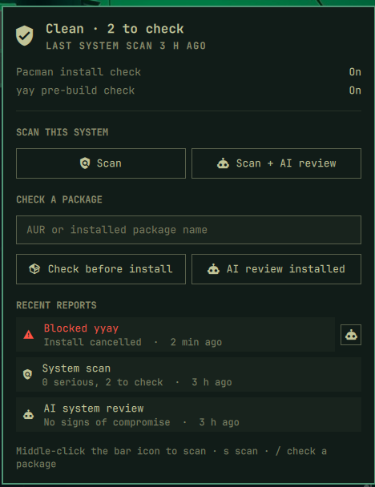

# AUR Audit for Omarchy

> [!WARNING]
> **This project was vibe coded through Claude Opus 5.5.** I described what I
> wanted, and the code, tests, and this README were written by AI, then tested
> by me on my own Arch Linux (Omarchy) system. I'm being fully transparent
> about that, so **use it with caution**: read the code before trusting it with
> your system.

An [Omarchy](https://omarchy.org/) bar widget and panel for
[aur-audit](https://github.com/TheDoodAbides87/aur-audit), the AUR malware
checker. It's a front-end only: every scan and check is still done by
aur-audit itself, so you need that installed first.



*(The reports in this screenshot are examples.)*

## What it does

**A shield in your bar** shows how things stand at a glance:

| Icon | Meaning |
|------|---------|
| Shield with a check | Your last system scan was clean |
| Red shield with `!` | An install was blocked since you last opened the panel, or your last scan found something serious |
| Dimmed outline | You haven't run a system scan in a while (7 days by default) |
| Dimmed crossed-out shield | aur-audit isn't installed |

**Clicking it opens a panel** where you can:

- See whether the pacman install check and the yay pre-build check are on.
- **Scan** your system (free, rule-based, about a minute), or **Scan + AI
  review** for a second opinion.
- **Check before install:** audit an AUR package by name without building it.
- **AI review installed:** have your AI assistant review a package you
  already have.
- Read your **recent reports**, and for a blocked package, ask your AI
  assistant whether it's actually malicious (the robot button).

Every action opens in a floating terminal and runs the real `aur-audit`
command, so you see the same output as on the command line. AI reviews still
show you the estimated token cost and ask `Send it? [y/N]` before anything
is sent.

**Shortcuts:** middle-click the bar icon to start a system scan. With the
panel open, press `s` to scan, `/` to type a package name, and `Esc` to close.

## Requirements

- Omarchy with the Quickshell-based shell (Omarchy 4.x)
- [aur-audit](https://github.com/TheDoodAbides87/aur-audit) installed and on
  your `PATH`
- `python3` (aur-audit already needs it)

## Install

1. **Install aur-audit first.** The plugin needs it and does no scanning of
   its own. Follow [aur-audit's install steps](https://github.com/TheDoodAbides87/aur-audit#install).
   Without it, the bar icon shows a crossed-out shield and the panel links you
   there.
2. Add the plugin:

```
omarchy plugin add https://github.com/TheDoodAbides87/aur-audit-omarchy.git --enable
```

Omarchy will warn you that plugins run unsandboxed and ask you to confirm.
That's a good moment to read the code: it's four files (see below).

The icon goes on the right of your bar. Move it with
`omarchy bar move thedoodabides87.aur-audit --section left` (or `center`). If
it doesn't show up straight away, run `omarchy restart shell`.

**Settings:** to change how many days pass before the icon reminds you to scan,
set `staleScanDays` on the widget's entry in `~/.config/omarchy/shell.json`.

## How it works

| File | What it does |
|------|--------------|
| `Panel.qml` | The bar icon and panel |
| `status.py` | Reads aur-audit's saved reports in your home folder and prints a short JSON summary. It only reads files and never runs aur-audit |
| `run.sh` | Opens a floating terminal and runs one aur-audit command |
| `manifest.json` | Tells Omarchy what the plugin is |

**Safety:** the panel can only start the six actions in `run.sh` (system
scan, scan + AI, check, AI review of a blocked package, AI review of an
installed package, and viewing a report). Package names are checked against
pacman's naming rules in the panel, `status.py` and `run.sh`, and are passed
as separate arguments that no shell re-reads. So a package name or a crafted
report can't sneak a command in. Nothing here uses `sudo`.

**What it stores:** one file,
`~/.local/state/aur-audit-omarchy/seen`, which holds the time you last opened
the panel (so old blocked installs stop turning the icon red). Reports themselves are aur-audit's own files
in your home folder.

## Tests

```
python3 -m unittest discover tests
```

## Uninstall

```
omarchy plugin remove thedoodabides87.aur-audit
rm -rf ~/.local/state/aur-audit-omarchy
```

This doesn't touch aur-audit itself or its reports.

## License

MIT
